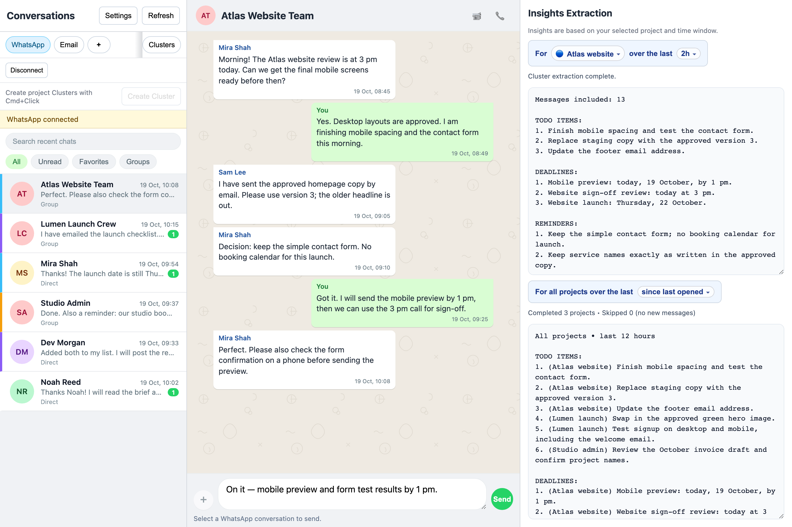
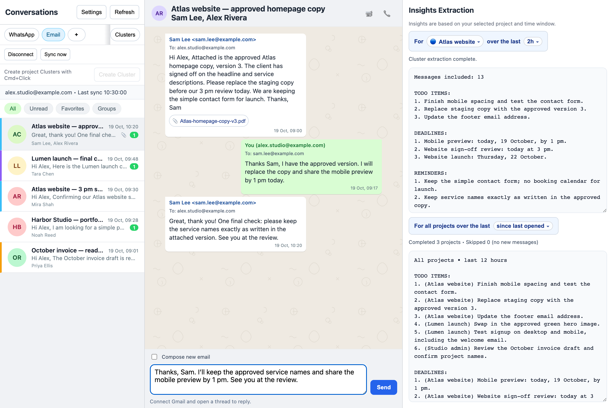
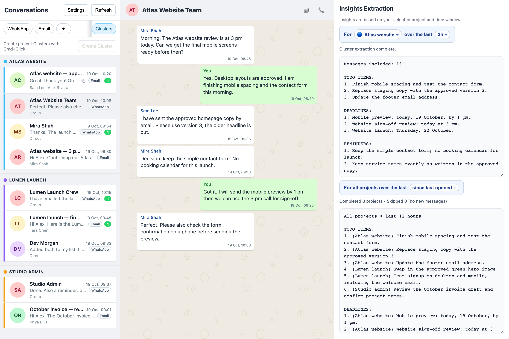
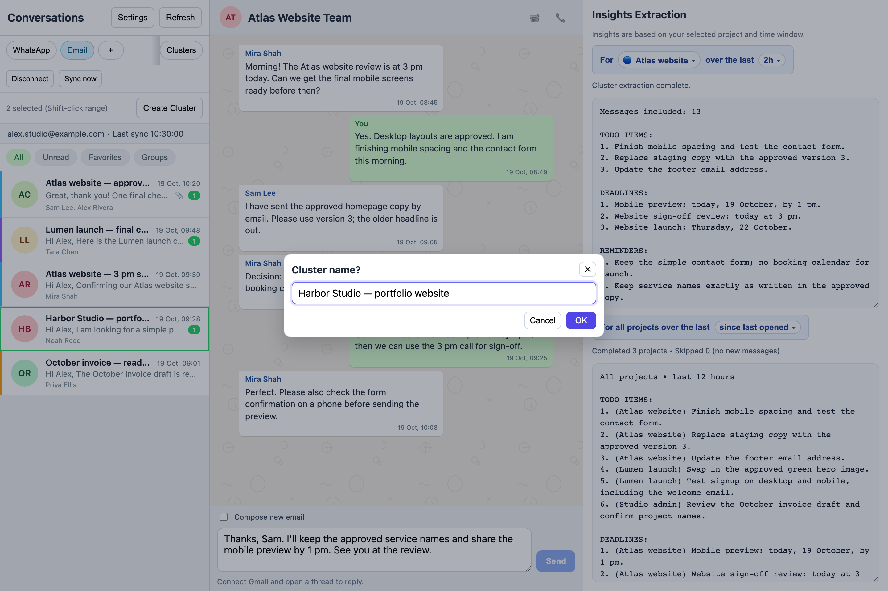
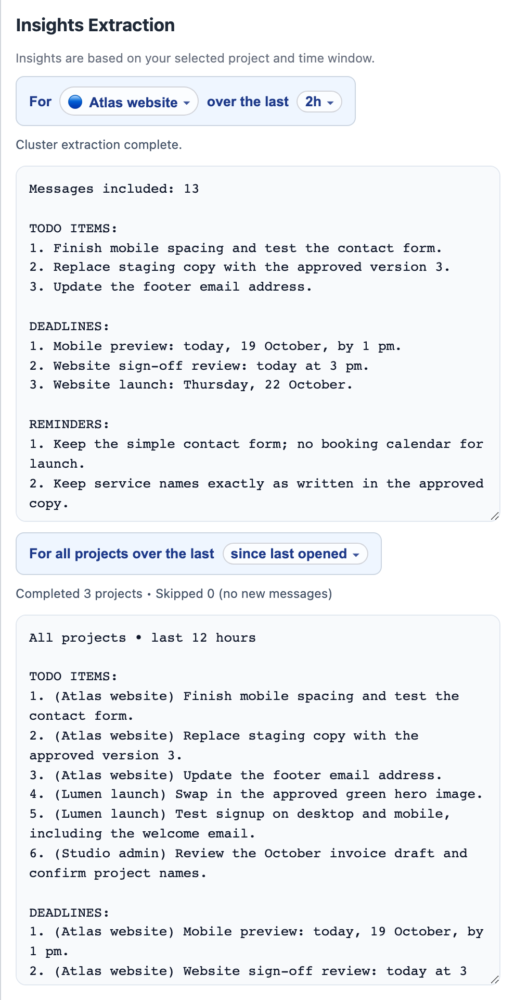
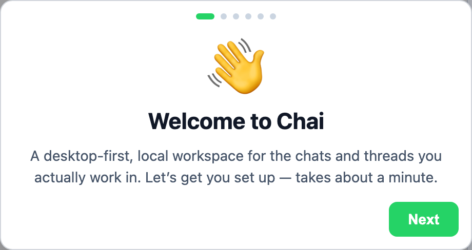
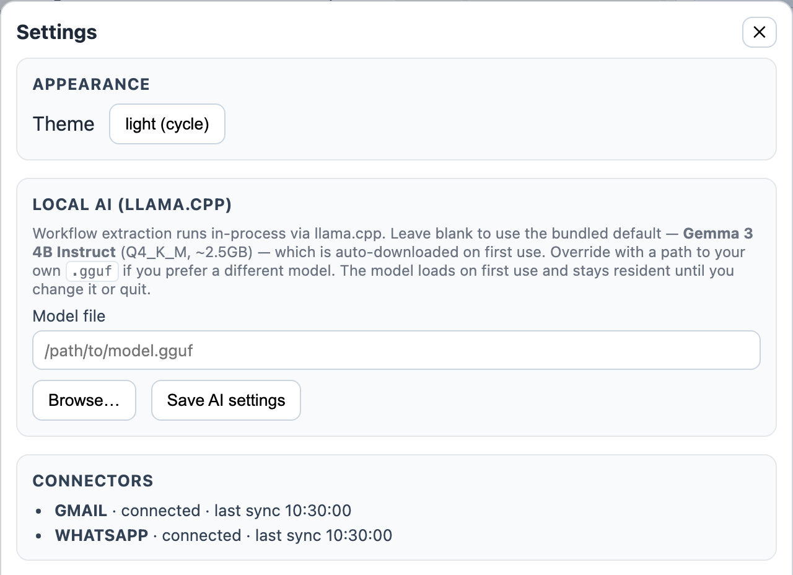
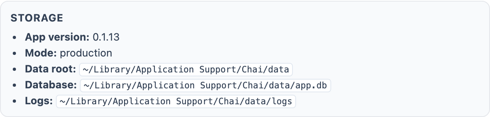

# Chai

**Client work lives in WhatsApp. Decisions arrive by email. Chai brings the context together.**

Chai is a desktop workspace for freelancers juggling clients across **personal WhatsApp and Gmail**. Read and reply in one place, group related conversations by client or project, and use local AI to pull out tasks, deadlines, reminders, assignments, and progress updates.

[Download the beta for macOS or Windows](https://github.com/no4jargon/Janus-Layer-0/releases/latest) · [Get started](#get-started) · [Developer setup](#development-commands)



*Screenshots show the actual app interface with fictional clients and messages. AI results are illustrative sample outputs. [Screenshot capture details](docs/screenshots/README.md).*

## Read the brief and reply where the work happens

Switch between WhatsApp chats and Gmail threads without leaving the workspace. For example, Mira shares quick design feedback in WhatsApp while Sam emails the approved Atlas website copy. Open the email, download its attachment, and draft a reply beside the project insights.



## Keep a client's conversations together

A **Cluster** is a project folder for conversations. Put the Atlas WhatsApp group and its email threads in one cluster, while keeping Lumen launch and Studio admin separate. The channel badges show where each conversation came from; the original threads remain available in their channel tabs.



## Start a project from the conversations you already have

Cmd-click on macOS or Ctrl-click on Windows to select related conversations across the WhatsApp and Email tabs, then choose **Create Cluster** and name the project. Shift-click selects a range. Right-click an existing cluster to rename it, change its color, or delete the grouping.



## Catch up on what needs doing

Choose a project and a lookback window to extract its tasks, deadlines, reminders, assignments, and progress updates from recent messages. Run **all projects** for a combined catch-up list with each item labeled by project. The **since last opened** option refreshes the connectors before collecting the catch-up.



Insights use the conversations in the chosen cluster and time window. Check the source messages before acting on AI output.

## Get started

1. [Download a beta installer](https://github.com/no4jargon/Janus-Layer-0/releases/latest) and install Chai on your Mac or Windows computer. Builds are currently unsigned; see the [installation notes](docs/QA_PLAN.md#6-updates).
2. Follow the in-app walkthrough. Connect WhatsApp by scanning its QR code from your phone's **Linked Devices**, and connect Gmail through Google sign-in in your browser.
3. Select a client's chats and email threads, create a cluster, and run insights for that project.



## Keep your workspace on your computer

Chai stores mirrored messages, project clusters, and saved AI outputs locally. Workflow extraction runs on your computer through llama.cpp, using **Gemma 3 4B Instruct** by default or your own GGUF model. The default model downloads about **2.5 GB** on first use.



Settings also shows the local data location, connection status, and diagnostic tools. Chai does not store your communications on its own servers; Gmail and WhatsApp still communicate with their respective providers to sync and send messages.



For people using a trusted assistant on the same computer, Chai also provides a [local agent bridge](docs/AGENT_BRIDGE.md) to read conversations, send messages, and create response-watch tasks. An external agent handles those tasks; Chai does not automatically reply on its own.

## Beta status

Chai is a **single-user desktop beta**. WhatsApp and Gmail are the supported channels. Mobile sync, additional channels, calling, and team collaboration are outside the current feature set.

Phases 1–4 are code complete for v1. The desktop version is owned by `apps/desktop/package.json`; the published beta documented here is [`v0.1.13`](https://github.com/no4jargon/Janus-Layer-0/releases/tag/v0.1.13). Gmail account acceptance, Windows installed UI QA, and signing remain operational acceptance steps. Personal WhatsApp support depends on WhatsApp Web behavior and may require reconnecting.

Project references: [Plan](docs/PLAN.md) · [Progress and known risks](docs/PROGRESS.md) · [QA checklist](docs/QA_PLAN.md) · [Release guide](docs/RELEASE.md).

## Monorepo layout

```text
apps/desktop                       Electron lifecycle, IPC, build/dev/package helpers
packages/ui                        React + Vite renderer
packages/core                      runtime composition (logger, settings, runtime, connector orchestrator)
packages/db                        SQLite bootstrap, migrations, typed repositories
packages/agent-bridge              local MCP/RPC bridge for trusted laptop agents
packages/connectors-gmail          Gmail OAuth, mirror sync, send service
packages/connectors-whatsapp       Baileys-backed WhatsApp connector + send service
packages/ai                        local model runtime
packages/ai-prompts                workflow extraction prompts + snapshots
packages/shared                    cross-package types
```

## Development commands

```bash
pnpm install            # install workspace deps
pnpm build              # builds all packages (TS -> dist) and the renderer
pnpm dev                # starts Electron + Vite (auto-builds packages first)
pnpm dev:ui             # renderer-only loop
pnpm package:desktop    # produces an unsigned dir Electron build under apps/desktop/dist
pnpm release:desktop    # unsigned installers; optional CSC_*/APPLE_* signing env
pnpm verify:data-paths  # smoke-tests dev/prod data paths + migrations
pnpm test:migrations    # runs the migration test harness (fresh + idempotent + v1-upgrade)
pnpm typecheck          # typecheck all packages
```

See `docs/RELEASE.md` for signing + publish details, and `docs/QA_PLAN.md` for the friends/family beta checklist.

`pnpm dev` triggers a one-shot build of `@chai/{shared,db,core,agent-bridge,connectors-gmail,connectors-whatsapp}` and `chai` so the Electron main process can resolve them at runtime.

## Local agent bridge

Chai starts a trusted local agent bridge with the desktop runtime. It binds to `127.0.0.1:43124` by default and exposes:
- MCP over HTTP at `/mcp`
- JSON RPC at `/rpc`

The bearer token is written to `<data>/agent-bridge.json` and is visible as a token-file path in Settings. Override with `CHAI_AGENT_BRIDGE_HOST`, `CHAI_AGENT_BRIDGE_PORT`, `CHAI_AGENT_BRIDGE_TOKEN`, or disable with `CHAI_AGENT_BRIDGE_DISABLED=1`.

For investment-run notifications to the WhatsApp Notes group, see
[`docs/INVESTMENT_NOTIFICATIONS.md`](docs/INVESTMENT_NOTIFICATIONS.md). The
`scripts/chai-notify.py` helper resolves and pins the group, then checks the
nested send result. The bridge is included starting with `v0.1.13`. See
[`docs/AGENT_BRIDGE.md`](docs/AGENT_BRIDGE.md) for authentication and tool usage.

## Reset commands (macOS)

```bash
pnpm app:rebuild            # rebuild the .app, DB preserved
pnpm app:rebuild-fresh      # wipe ALL app data (DB, settings, OAuth tokens, logs), then rebuild
pnpm clear:app              # wipe ALL Chai app files, including /Applications/Chai.app, ~/Library/Application Support/Chai, and .dev-data
pnpm db:wipe                # wipe just the SQLite database; OAuth tokens + settings stay
```

Quit the app before running `app:rebuild-fresh`, `clear:app`, or `db:wipe` — Electron has the SQLite WAL open while running, and a live instance will write its in-memory state back over your reset.

These scripts target the macOS app bundle path (`/Applications/Chai.app`) and userData path (`~/Library/Application Support/Chai/`). On Windows/Linux the paths are different; use `pnpm verify:data-paths` to print the exact location for your platform.

## Runtime data conventions

- Development data root: `<repo>/.dev-data/`
- Production data root: `<os-user-data>/data/`
- Pre-migration backups: `<data>/backups/app-pre-migration-<timestamp>.db`

## Connector environment

Copy `.env.example` to `.env` (loaded by the desktop runtime) and configure:
- `GOOGLE_CLIENT_ID`
- `GOOGLE_CLIENT_SECRET`
- `GOOGLE_REDIRECT_URI` (default desktop callback: `http://127.0.0.1:43123/oauth/google/callback`)

WhatsApp pairing is QR-driven inside the desktop window and does not require env configuration.
